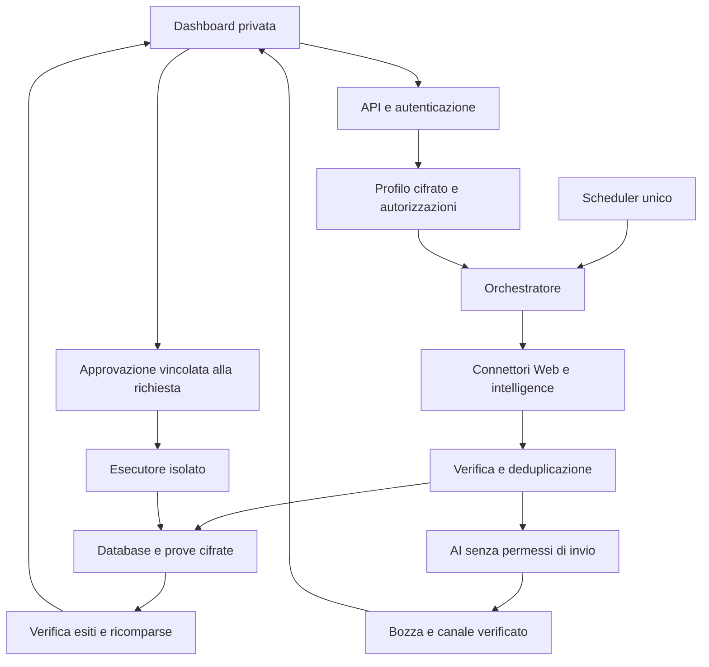

# Progetto operativo — Agente AI di privacy digitale personale

Versione 1.2 · 12 novembre 2026 · Rimozione dai data broker e verifica di progetti GitHub

**Obiettivo:** individuare esposizioni dei tuoi dati, produrre una lista documentata con URL e canali di rimozione verificabili, preparare le richieste, eseguirle solo dopo la tua approvazione e controllarne gli esiti nel tempo. Ricerca automatica, fonti lecite per breach e Dark Web, monitoraggio periodico.

**Destinazione del prodotto:** progetto distribuibile tramite un repository pubblico GitHub. Ogni utilizzatore installa l'app, crea il proprio accesso e inserisce i propri identificativi in una configurazione iniziale privata. Nel documento “tu” indica l'utilizzatore dell'installazione, non necessariamente l'autore del repository. Nessun dato dell'autore è precompilato. Questa versione definisce installazioni personali separate; un servizio centralizzato con più utenti richiede una successiva architettura di isolamento tra account.

**Funzione principale aggiunta:** gestione continuativa della rimozione dai data broker e dai siti di ricerca persone, sul modello funzionale di servizi come Incogni, DeleteMe e Sheeldy. Il sistema identifica i broker pertinenti, cerca esposizioni dove possibile, prepara richieste mirate, gestisce risposte e verifiche e controlla le ricomparse. Non presume accesso alle integrazioni private o ai cataloghi proprietari di questi servizi. La ricerca GitHub e la scelta dei componenti riutilizzabili sono documentate nella sezione 21.

Questo documento è una specifica per costruire il sistema. Non è il risultato di una ricerca sulla tua identità: non sono state effettuate scansioni personali, acquistate API, inviate richieste o attivate pianificazioni. I link ufficiali riportati sono punti di accesso verificati documentalmente alla data del documento; non provano che un servizio possieda dati che ti riguardano. Il completamento dei moduli non è stato provato.

## 1. Decisioni di prodotto e confini

| Aspetto | Decisione operativa |
|---|---|
| Interessato | Un solo utilizzatore per installazione, con i propri dati; nessuna estensione implicita a familiari, colleghi o omonimi |
| Distribuzione | Codice e documentazione pubblici su GitHub; dati operativi in archivio privato separato dal repository |
| Installazione | Servizio personale su macchina sempre accesa o server privato; dashboard raggiungibile tramite VPN e autenticazione |
| Ricerca | Automatizzata entro identificativi, fonti, quote e modalità autorizzate |
| Azioni esterne | Ogni richiesta, allegato, conferma di opt-out e sollecito richiede approvazione specifica |
| Dark Web | Informazioni provenienti da un fornitore autorizzato, con contratto e provenienza documentata; nessun crawler Tor nel progetto |
| Decisioni AI | Estrazione assistita, sintesi e bozze; autorizzazioni e invii governati da codice deterministico |
| Risultati | Stato della corrispondenza, stato dell'esposizione e stato della richiesta sempre separati |
| Ambito giuridico | Flusso Italia/UE quando applicabile; residenza e contesto da registrare nella configurazione |

La dashboard deve distinguere quattro azioni: cancellazione del dato alla fonte, deindicizzazione, opposizione/opt-out dal trattamento e chiusura dell'account. Disiscriversi da una newsletter non equivale a cancellare un account; l'opt-out pubblicitario non dimostra la cancellazione di tutti i dati. La chiusura degli account è disabilitata nella prima versione e richiede un flusso dedicato per conseguenze, abbonamenti e dati da esportare.

### Configurazione iniziale

Inserire i dati nel pannello protetto, senza incorporarli nel codice o nei file di configurazione distribuiti:

- Nome, cognome e varianti realmente utilizzate.
- Email attuali e storiche; prova del controllo ove disponibile. Per quelle non più accessibili: conferma manuale dell'associazione, con limite sui successivi invii.
- Telefoni con prefisso internazionale e periodo di utilizzo: un vecchio numero potrebbe essere stato riassegnato.
- Username e URL di profili già conosciuti; città e vecchi indirizzi solo se necessari a discriminare omonimi.
- Paese di residenza, lingue, fonti ammesse/escluse, casella per le richieste privacy e canale per gli avvisi.
- Autorizzazione alla ricerca per ciascun fornitore e categoria di dato, budget e frequenze.

Non chiedere password personali, copie di documenti, codice fiscale o dati sanitari come prerequisito generale. Se un identificativo particolarmente delicato è indispensabile per un caso, acquisirlo separatamente e limitarne l'uso. Non cercarlo automaticamente su motori pubblici.

### Flusso della prima configurazione

1. **Crea l'accesso personale.** Installazione e autenticazione precedono l'inserimento di dati reali. Una demo pubblica usa solo identità sintetiche e rifiuta scansioni reali e chiavi personali.
2. **Scegli cosa cercare.** Per una ricerca email basta almeno un'email; nome, telefono e indirizzo non diventano obbligatori per funzioni che non li richiedono. La UI spiega perché viene chiesto ogni campo.
3. **Verifica gli identificativi.** Per l'email, quando supportato, usa conferma dell'indirizzo; per il telefono solo un meccanismo disponibile e configurato. Gli identificativi storici senza verifica restano autodichiarati, con restrizioni sugli invii. Nome e indirizzo non sono “verificati” da una semplice casella di conferma.
4. **Configura le fonti.** L'utente abilita i connettori disponibili e, dove richiesto, inserisce le proprie chiavi API nell'archivio dei segreti. Nessuna chiave del manutentore è inclusa nella distribuzione.
5. **Rivedi dati e destinazioni.** Mostra quali identificativi saranno inviati a ciascun provider, eventuale modello remoto, finalità, frequenza e budget. L'autorizzazione alle ricerche resta distinta dall'approvazione delle singole cancellazioni.
6. **Avvia esplicitamente.** Il pulsante “Avvia la prima ricerca” completa la configurazione. Il monitoraggio periodico si attiva solo se selezionato, con frequenze visibili. L'apertura dell'app o il salvataggio di un campo non avviano query esterne.

| Dato richiesto | Quando serve | Regola di raccolta |
|---|---|---|
| Email personale | Lookup breach o ricerca Web per email | Obbligatoria soltanto per quelle funzioni; verifica del controllo ove possibile |
| Nome e cognome | Ricerca di pagine riferite alla persona | Facoltativi per la modalità solo email; omonimi da revisionare |
| Telefono | Ricerca del numero | Facoltativo; prefisso e periodo di utilizzo |
| Username e profili | Ricerca di identità pubbliche note | Facoltativi, aggiunti esplicitamente |
| Città/indirizzo storico | Disambiguazione di un caso | Raccolta solo se utile; nessun obbligo generalizzato |
| Paese e lingua | Procedure applicabili e interfaccia | Senza chiedere posizione precisa o documenti |
| Chiavi API | Connettori che le richiedono | Separate dagli identificativi; mai in URL, log o repository |

**Stato del profilo:** `empty → draft → ready → monitoring`, con `paused` e `deletion_pending`. Il passaggio a `ready` richiede almeno un identificativo utilizzabile e una fonte autorizzata compatibile. Ogni modifica agli identificativi richiede revisione del relativo ambito prima di trasmetterli a nuovi provider. Nessuna inferenza di nuovi identificativi viene automaticamente aggiunta al perimetro.

API e worker applicano gli stessi controlli: scansioni manuali solo da profilo `ready` o `monitoring`; attività periodiche solo con monitoraggio abilitato; nessuna nuova scansione da profilo `empty`, `draft`, `paused` o `deletion_pending`. Ricontrollare stato e autorizzazioni anche quando il lavoro lascia la coda, non soltanto quando viene creato.

Conservare i campi in memoria durante la compilazione o in una bozza server cifrata con scadenza breve dichiarata; evitare localStorage, parametri URL, strumenti analytics e registrazioni delle sessioni sui moduli. Validare anche sul server; gli errori non devono riecheggiare i valori nei log. L'accesso ai risultati e agli URL completi richiede autenticazione e usa risposte non memorizzabili nelle cache condivise.

Dal pannello “I miei dati” l'utilizzatore può correggere identificativi, sospendere i controlli, revocare fonti, esportare i risultati e chiedere la cancellazione del profilo locale. Quest'ultima è distinta dalle richieste di cancellazione ai siti esterni. La procedura sospende i lavori, revoca le approvazioni non consumate e gestisce le watchlist dei provider secondo il contratto.

Le ricerche restano personali: niente API pubblica per interrogazioni anonime, scansioni massive o caricamenti di liste di terzi. Limitare frequenza e tentativi anche sulle conferme email/telefono. Il controllo di una casella dimostra il controllo dell'indirizzo, non l'identità di chi compare in ogni pagina trovata.

### Repository pubblico e dati privati

La prima release è un'app personale installabile sul computer o server dell'utente. La dashboard non viene resa pubblica insieme al repository. Il manutentore non riceve automaticamente profili, risultati o chiavi; i provider abilitati ricevono soltanto quanto previsto dalla configurazione. Telemetria e invio di diagnostica esterna sono disabilitati per impostazione iniziale.

| Pubblicabile nel repository | Da mantenere nell'installazione privata |
|---|---|
| Codice, migrazioni e documentazione | Identificativi e profilo dell'utilizzatore |
| `.env.example` con valori vuoti o sintetici | `.env`, chiavi API, OAuth, cookie e chiavi di cifratura |
| Fixture e schermate con identità sintetiche | Database, prove, screenshot reali, esportazioni e backup |
| Registro revisionato di procedure ufficiali | URL personalizzati con identificativi o token |
| Workflow CI e test con servizi simulati | Risposte reali dei provider e richieste di cancellazione |

Prevedere `README.md`, istruzioni di installazione e onboarding, `CONTRIBUTING.md`, `SECURITY.md`, avvisi nelle issue e nei moduli di segnalazione per non allegare dati personali, nonché una licenza da scegliere prima della release. La sola visibilità pubblica non definisce i diritti di riutilizzo: la scelta della licenza resta una decisione esplicita del progetto.

La directory dei dati operativi va esterna al checkout; aggiungere `.gitignore` e `.dockerignore` per escludere segreti, dump, prove e backup dagli strumenti di sviluppo e dalle immagini. La pipeline pubblica usa fixture sintetiche, non esegue scansioni personali e non espone segreti alle build di contributi esterni. Verificare sia i file sia gli artefatti di release e la cronologia Git prima della prima pubblicazione.

Il file `.gitignore` non esclude retroattivamente file già tracciati. Se una credenziale viene pubblicata, revocarla/ruotarla e valutare la pulizia della cronologia; copie e fork possono conservarla. Questa regola entra nel runbook del progetto, senza affidare la protezione dei dati al solo elenco di esclusione. [S16, S17]

**Eventuale servizio multiutente futuro:** introdurre account separati, chiavi e credenziali per account, isolamento delle query e dei job, controlli di accesso per oggetto e test tra account. In quel caso il vincolo singleton per l'intero database andrà sostituito da un vincolo sul profilo per account. Il repository pubblico da solo non richiede questa trasformazione e la versione corrente non dichiara di supportarla.

## 2. Architettura



Un'applicazione modulare è sufficiente: evitare una rete di agenti autonomi per un singolo utente. Separare comunque il processo di raccolta da quello che può inviare richieste; il secondo dispone delle sole credenziali strettamente necessarie. Browser di raccolta ed esecuzione utilizzano profili e sessioni distinti.

| Componente | Scelta proposta | Compito |
|---|---|---|
| Backend | Python, FastAPI, Pydantic | Contratti API, validazione, sessioni, permessi |
| Persistenza | PostgreSQL, SQLAlchemy, Alembic | Stato autorevole, vincoli, migrazioni |
| Lavori | Celery + Redis, Celery Beat | Code separate, scansioni e verifiche |
| HTTP | httpx | Timeout, quote, retry e client specifici per fonte |
| Estrazione | Beautiful Soup o Trafilatura | Testo e link da pagine acquisite |
| Normalizzazione | phonenumbers, regole esplicite | Telefoni e varianti controllate |
| Browser | Playwright, container effimero | Solo procedure consentite che richiedono rendering |
| Cifratura | Libreria crittografica mantenuta, AEAD | Cifratura autenticata e gestione versioni delle chiavi |
| AI | Adattatore sostituibile, locale per impostazione iniziale | Classificazione e bozze su dati minimizzati |
| Frontend | Template server con Jinja2 e interazioni leggere | Elenco risultati, prove, approvazioni e storico |
| Esercizio | Container, reverse proxy, metriche prive di PII | Avvio riproducibile, salute e backup |

Bloccare le dipendenze e le immagini a versioni e digest verificati all'avvio dell'implementazione; aggiornamenti con controlli di compatibilità. La selezione di queste librerie è una scelta progettuale, non una certificazione di sicurezza del prodotto.

Redis contiene solo UUID di lavori e riferimenti opachi, senza email, query, testo delle pagine o allegati. PostgreSQL mantiene lo stato; perdere Redis non deve perdere richieste o autorizzazioni. Una outbox transazionale collega modifiche DB e accodamento.

## 3. Fonti e API esterne

### Ricerca Web

Connettore iniziale: Brave Search API, `GET https://api.search.brave.com/res/v1/web/search`, parametro `q`, chiave nell'header `X-Subscription-Token`. Usare query esatte per email e username e combinazioni nome+città. Conservare solo risultati e prove ammesse dai termini del piano; verificare prima diritti di memorizzazione e uso con AI. Quote e limitazione del traffico sono configurabili. Documentazione ufficiale: [S1], [S2].

Le query trasmettono al motore gli identificativi ricercati: spiegarlo nella configurazione e registrare le fonti autorizzate. L'API di un motore non descrive tutto Internet. La mancata restituzione di una pagina non prova la sua assenza. Evitare come base tecnica lo scraping delle pagine di Google.

### Breach: Have I Been Pwned

Base REST `https://haveibeenpwned.com/api/v3`. Usare `GET /breachedAccount/{email}` con URL encoding, `hibp-api-key` e `User-Agent`; `GET /breaches` per il catalogo. Se il piano lo consente, preferire `GET /breachedaccount/range/{prefix}` per la ricerca email con k-anonymity, scartando subito le corrispondenze di terzi. La ricerca pubblica esclude breach sensibili o ritirati; gli stealer log richiedono abilitazioni e verifica del dominio, quindi non presumere disponibilità per caselle Gmail/Outlook. `429`: rispettare `Retry-After`. `404`: nessuna corrispondenza restituita, non assenza globale di esposizioni. [S3]

Per limitare le ricerche: aggiornare il catalogo e verificare le email secondo frequenza e piano, con cache dei soli metadati consentiti. Non interrogare interi domini per recuperare informazioni di altre persone.

### Dark Web e infostealer

Prevedere un adattatore `LicensedExposureProvider`. SpyCloud è un candidato da valutare: la documentazione pubblica descrive API per dati da breach, malware e phishing, anche in contesti di protezione consumer. Non è stata verificata l'accessibilità economica o contrattuale per un singolo privato. Documentazione e contratto devono stabilire prodotto, endpoint, campi restituiti e autorizzazione del tuo caso d'uso. [S4]

Gate obbligatorio per attivare l'adattatore:

1. Conferma scritta di uso personale e interrogazioni limitate ai tuoi identificativi.
2. Provenienza e modalità di acquisizione accettabili, trattamento dei dati, retention e canale per esercitare i diritti.
3. Possibilità di ricevere metadati minimizzati, escludendo password, cookie, token e contenuti di terzi lato fornitore.
4. API o webhook documentati, autenticazione, rate limit, cancellazione watchlist e condizioni di conservazione.
5. Preventivo approvato e prova con identità di test autorizzate.

Se il fornitore restituisce segreti non richiesti, filtrarli al confine in memoria, senza log, cache o risposta grezza persistente. Se non si può evitare un'acquisizione eccessiva, non attivare quel prodotto.

Nessun endpoint commerciale viene inventato in questo progetto. Se non è disponibile un contratto adatto, indicare **Dark Web non attivo** e mantenere funzionanti Web e breach; un eventuale import manuale documentato non equivale a monitoraggio automatico. Non usare indicazioni generiche “sicuro” o “nessun dato nel Dark Web”.

### Invio delle richieste

Un adattatore email utilizza OAuth del provider scelto, permessi minimi e una casella dedicata. I moduli Web hanno adattatori per dominio, revisionati e versionati; non esiste una generica API universale di cancellazione. Google e altri servizi senza un'integrazione pubblica documentata vengono gestiti come procedura assistita: prepara i campi, apri il canale ufficiale e lascia all'utente login, CAPTCHA o conferma quando necessario.

Le email ricevute per una pratica sono contenuti non affidabili. Non aprire automaticamente allegati o link di conferma: una conferma che realizza l'opt-out è anch'essa un'azione da autorizzare. Non attribuire valore di ricevuta al solo titolo di un'email.

### Modulo dedicato: rimozione dai data broker

Le fonti ufficiali dei servizi di riferimento descrivono raccolta del profilo, richieste ai broker, tracciamento e controlli ricorrenti; DeleteMe documenta anche richieste personalizzate su URL segnalati dall'utente. Sheeldy descrive richieste a broker e piattaforme pubblicitarie e monitoraggio delle violazioni. Queste descrizioni sono un riferimento funzionale, non una verifica indipendente della copertura o dei risultati dei servizi. [S18–S21]

| Funzione da costruire | Comportamento dell'app |
|---|---|
| Catalogo broker | Registro versionato di organizzazioni, domini, paesi, procedure e dati minimi necessari |
| Individuazione | Ricerca di schede pubbliche e confronto con gli identificativi autorizzati |
| Broker senza schede pubbliche | Stato di possesso sconosciuto; eventuale richiesta mirata da approvare, senza inventare un'esposizione |
| Rimozioni | Bozze di cancellazione, opposizione, opt-out o richiesta di informazioni, secondo il caso |
| Gestione risposte | Associazione alla pratica, richieste di verifica, dinieghi, conferme e scadenze |
| Richieste personalizzate | L'utente segnala un URL; l'app verifica attribuzione e canale ufficiale |
| Controlli ricorrenti | Nuove verifiche e nuove bozze in caso di ricomparsa; invii sempre approvati |
| Report | Broker pertinenti, controllati, con riscontri, contattati e con esiti verificabili |

**Tre livelli di copertura, mostrati separatamente:** un broker può essere soltanto nel catalogo (`catalogued`), avere una procedura ufficiale revisionata (`procedure_reviewed`) oppure un adattatore collaudato (`adapter_tested`). Nessuno di questi stati dimostra che possieda dati dell'utente. La dashboard mostra anche cosa è automatico, assistito o soltanto manuale. Il numero di domini nel catalogo non viene pubblicizzato come numero di cancellazioni automatizzate affidabili.

Il catalogo distingue people-search pubblico, marketing/ad-tech, aggregatori B2B e altri titolari pertinenti. Non classificare automaticamente tutti i titolari o tutti i membri di un'associazione come broker che possiedono i dati dell'utente. Registrare relazioni tra società e marchi per evitare richieste duplicate; una cancellazione presso un gruppo non prova l'esito su ogni sito collegato.

**Flusso operativo:**

1. Seleziona i broker per paese, tipo di dato, fonti autorizzate e procedure effettivamente disponibili.
2. Per i siti pubblici, cerca la scheda e verifica la corrispondenza prima di trasmettere altri dati.
3. Per un broker non pubblico, indica `holding_state=unknown`. Proponi una richiesta solo con canale ufficiale e motivazione pertinente, mostrando che potrebbe rivelare identificativi non ancora posseduti dal destinatario. Nessun invio indiscriminato a tutto il catalogo.
4. Scegli il diritto e prepara i campi minimi. Una richiesta di accesso e una di cancellazione sono azioni distinte: non concatenarle senza autorizzazione.
5. Mostra l'anteprima ed esegui dopo approvazione. La casella dedicata dell'utente può essere usata per corrispondenza e ricevute con autorizzazione specifica alla lettura delle pratiche.
6. Classifica la risposta come proposta da revisionare; conferme, documenti o dinieghi non vengono accettati dal solo riconoscimento di parole chiave.
7. Verifica l'esito con accesso valido alla scheda o conserva la sola dichiarazione del titolare quando la banca dati non è pubblica.
8. Pianifica il ricontrollo. Una ricomparsa genera una nuova azione approvabile; un sollecito periodico non viene inviato senza verificarne necessità e condizioni.

**Approvazione di più pratiche:** la UI può consentire una selezione in gruppo, purché mostri ogni broker, azione, destinatario e payload e registri approvazioni separate per ciascuno snapshot. Cambiare una pratica invalida la sua approvazione; nessuna autorizzazione generale sostituisce l'approvazione degli invii prevista dal progetto. Nell'installazione personale le richieste partono dall'utente: un mandato a un servizio terzo non è un prerequisito universale. Se il prodotto futuro agisse come rappresentante centralizzato, delega e requisiti dei destinatari richiederebbero un flusso dedicato.

**Suppression e cancellazione:** registrare `suppression_declared` separatamente da `erasure_declared`. Una lista di soppressione può mantenere identificativi minimi per evitare nuove inclusioni; non significa necessariamente eliminazione totale. Anche un'esposizione rimossa dal sito può restare in archivi del titolare soggetti a obblighi differenti.

Ogni procedura è descritta da un manifesto JSON/YAML pubblico senza dati personali: `broker_id`, organizzazione, domini, paesi, `discovery_mode`, azioni supportate, URL ufficiali, campi necessari, fasi di verifica, `adapter_version`, `source_url`, `source_commit`, `source_license`, data dell'ultima revisione e livello di test. Schema chiuso e validazione server; niente script arbitrari scaricati ed eseguiti dal catalogo. Gli aggiornamenti di destinatari o campi richiedono revisione e non acquisiscono automaticamente le approvazioni precedenti.

Gli adattatori Python espongono `discover`, `prepare_request`, `submit_approved` e `verify_outcome`. La preparazione dei moduli che esegue validazioni remote può già trasmettere dati: avviene nel contesto dell'azione autorizzata, non in una “preview” che promette assenza di trasmissioni. Prima dell'approvazione, l'anteprima si genera localmente sullo snapshot. Non usare un compilatore generico che indovini il primo modulo della pagina e prema “Invia”. CAPTCHA, documenti e flussi non collaudati passano a intervento assistito.

## 4. Pipeline di ricerca e verifica dell'identità

1. **Pianifica:** seleziona solo identificativi attivi e fonti autorizzate; stima quota e costo.
2. **Cerca:** esegui combinazioni limitate, registra la copertura effettiva per fonte.
3. **Acquisisci:** fetch minimo, senza login di raccolta; browser solo se ammesso e necessario.
4. **Estrai:** rileva localmente identificativi e riferimenti, minimizza quelli di terzi.
5. **Confronta:** regole deterministiche, contesto temporale ed eventuale revisione umana.
6. **Deduplica:** collega le osservazioni allo stesso finding; conserva separati siti diversi e incidenti diversi.
7. **Valuta:** priorità del danno e affidabilità dell'evidenza.
8. **Trova il canale:** procedura ufficiale e requisiti, senza inviare identificativi.
9. **Prepara:** bozza limitata al caso, con approvazione richiesta.

**Regole di corrispondenza iniziali:**

| Evidenza | Stato ammesso | Conseguenza |
|---|---|---|
| Email esatta e attuale verificata, presente nel contenuto | Forte corrispondenza dell'identificativo | Può generare una bozza; non prova da sola chi abbia creato l'account |
| Nome e cognome + più riscontri coerenti indipendenti | Probabile | Conferma personale prima di preparare l'invio |
| Solo nome, solo città o username comune | Possibile | Rimane da verificare |
| Numero storico fuori dal tuo periodo di uso | Ambigua | Revisione; nessuna richiesta automatica |
| Risultato API con incidente segnalato come non verificato | Segnalazione non confermata | Avviso distinto e conferma prima delle azioni |
| Informazioni incompatibili o tua esclusione | Scartata | Soppressione del falso positivo, rivedibile |

Separare `identifier_match` dalla `incident_reliability`: una email può coincidere esattamente anche se il presunto leak è falso. Più copie della stessa pagina non sono riscontri indipendenti.

Conservare il valore originale e una copia normalizzata con regole specifiche del provider. Non togliere automaticamente punti e suffissi `+` da tutte le email; non fondere account o username per somiglianza. Per gli indirizzi usare trasformazioni conservative. Un punteggio iniziale è una graduatoria interna, non una probabilità statistica; calibrarlo sul set di verifica.

## 5. Database e cifratura

### Modello logico

Tutte le tabelle che dipendono dal profilo sono vincolate a un unico `subject_id` per installazione. Il vincolo singleton vale per ciascun database privato, non per tutte le persone che scaricano il codice da GitHub. UUID come identificatori; `timestamptz` in UTC e presentazione in `Europe/Rome`. Nessuna password esposta o raccolta viene salvata. I campi marcati “cifrato” includono versione chiave, nonce e ciphertext autenticato.

| Tabella | Campi principali | Vincoli e utilizzo |
|---|---|---|
| `subjects` | id, singleton_slot, profile_cipher, profile_status, created_at | `singleton_slot=1` e UNIQUE: un solo interessato per installazione |
| `identifiers` | id, subject_id, kind, value_cipher, lookup_hmac, ownership_state, verification_method, verified_at, valid_from/to, active | UNIQUE su soggetto, tipo e HMAC; storico dei periodi e verifiche |
| `providers` | id, name, capabilities, terms_reviewed_at, health_state | Config senza segreti; credenziali nel secret store |
| `brokers` | id, legal_entity, domains, countries, category, parent_ref, source_license, source_commit | Catalogo pubblico senza identificativi degli utenti |
| `broker_procedures` | id, broker_id, manifest_version, route_id, required_fields, support_level, reviewed_at, tested_at | Separazione tra catalogo, procedura e adattatore collaudato |
| `broker_cases` | id, subject_id, broker_id, holding_state, case_state, basis_cipher, next_check_at | Pratica privata anche senza finding pubblico; UNIQUE soggetto+broker |
| `broker_case_findings` | broker_case_id, finding_id | Associa più schede o incidenti alla stessa pratica |
| `authorizations` | id, subject_id, provider_id, scope_cipher, granted_at, revoked_at | Categorie e identificativi ammessi; revoca blocca nuovi lavori |
| `schedules` | id, provider_id, authorization_id, expression, timezone, next_run_at, paused | Un job per intervallo; nessuna sovrapposizione |
| `scan_runs` | id, subject_id, trigger, status, started_at, finished_at, counters | Stato complessivo: complete, partial, failed |
| `scan_checks` | id, run_id, provider_id, identifier_id, outcome, error_code, checked_at | SUCCESS_EMPTY diverso da ERROR, SKIPPED e UNSUPPORTED |
| `findings` | id, subject_id, source_kind, provider_id, fingerprint_hmac, details_cipher, match_state, severity, exposure_state, first/last_seen | UNIQUE soggetto+fingerprint; dati e URL cifrati |
| `finding_identifiers` | finding_id, identifier_id, match_method, evidence_ref | Collega più identificativi senza duplicare il risultato |
| `observations` | id, finding_id, scan_check_id, observed_at, evidence_cipher, evidence_hash, observation_outcome | Prove versionate e stato delle singole verifiche |
| `removal_routes` | id, target_domain, route_cipher, route_state, route_version, verified_at, expires_at | URL, delega esterna, fonte ufficiale, campi e adattatore |
| `removal_requests` | id, finding_id oppure broker_case_id, route_id, request_kind, revision, snapshot_cipher, snapshot_hash, state, received_at, due_at | Una radice della pratica; snapshot immutabile dopo proposta; revisione se cambia |
| `approvals` | id, request_id, snapshot_hash, approved_by, approved_at, expires_at, revoked_at, consumed_at | Approvazione valida solo per la revisione esatta |
| `executions` | id, request_id, approval_id, idempotency_key, status, receipt_cipher, started/finished_at | Chiave univoca, ricevuta e tentativi incerti separati |
| `outbox_events` | id, event_type, aggregate_id, created_at, dispatched_at | Transazione con l'aggiornamento del dominio |
| `audit_events` | id, event_type, actor, object_id, occurred_at, safe_metadata, chain_hash | Nessun corpo richiesta, email o identificativo in chiaro |

`details_cipher` contiene URL esatto dell'esposizione, riferimento privato del provider, identificativi mascherati, spiegazioni e metadati sensibili. Anche gli URL possono contenere dati personali e token. `target_domain` in chiaro è un metadato ridotto ma potenzialmente sensibile: proteggere l'intero volume e limitarne l'accesso.

Chiavi di deduplicazione: HMAC con chiave distinta dalla cifratura, calcolato su rappresentazione canonica e ambito. Evitare hash semplici di email o telefono, facilmente enumerabili. Non normalizzare gli URL eliminando parametri funzionali, ID profilo o firme. Conservare URL originale cifrato e chiave canonica separata.

### Estratto SQL dei vincoli critici

Questo estratto illustra il nucleo da tradurre in migrazioni; non è il DDL completo del sistema.

```sql
CREATE TABLE subjects (
  id uuid PRIMARY KEY,
  singleton_slot smallint NOT NULL UNIQUE CHECK (singleton_slot = 1),
  profile_cipher bytea NOT NULL,
  profile_status text NOT NULL DEFAULT 'draft' CHECK (profile_status IN (
    'empty','draft','ready','monitoring','paused','deletion_pending'
  )),
  created_at timestamptz NOT NULL DEFAULT now()
);

CREATE TABLE identifiers (
  id uuid PRIMARY KEY,
  subject_id uuid NOT NULL REFERENCES subjects(id),
  kind text NOT NULL CHECK (kind IN ('email','phone','name','username','address')),
  value_cipher bytea NOT NULL,
  lookup_hmac bytea NOT NULL,
  ownership_state text NOT NULL,
  verification_method text,
  verified_at timestamptz,
  active boolean NOT NULL DEFAULT true,
  UNIQUE (subject_id, kind, lookup_hmac)
);

CREATE TABLE removal_requests (
  id uuid PRIMARY KEY,
  finding_id uuid, -- FK alla tabella findings nella migrazione completa
  broker_case_id uuid, -- FK a broker_cases nella migrazione completa
  route_id uuid NOT NULL,   -- FK a removal_routes nella migrazione completa
  request_kind text NOT NULL,
  revision integer NOT NULL CHECK (revision > 0),
  snapshot_cipher bytea NOT NULL,
  snapshot_hash bytea NOT NULL,
  state text NOT NULL CHECK (state IN (
    'draft','awaiting_approval','approved','executing','submitted',
    'awaiting_user','delivery_unknown','responded','closed','cancelled'
  )),
  received_at timestamptz,
  due_at timestamptz,
  UNIQUE (id, snapshot_hash),
  CHECK ((finding_id IS NOT NULL) <> (broker_case_id IS NOT NULL))
);

CREATE TABLE approvals (
  id uuid PRIMARY KEY,
  request_id uuid NOT NULL,
  snapshot_hash bytea NOT NULL,
  approved_by uuid NOT NULL REFERENCES subjects(id),
  approved_at timestamptz NOT NULL DEFAULT now(),
  expires_at timestamptz NOT NULL,
  revoked_at timestamptz,
  consumed_at timestamptz,
  FOREIGN KEY (request_id, snapshot_hash)
    REFERENCES removal_requests(id, snapshot_hash),
  CHECK (expires_at > approved_at)
);

CREATE TABLE executions (
  id uuid PRIMARY KEY,
  request_id uuid NOT NULL REFERENCES removal_requests(id),
  approval_id uuid NOT NULL UNIQUE REFERENCES approvals(id),
  idempotency_key text NOT NULL UNIQUE,
  status text NOT NULL,
  receipt_cipher bytea,
  started_at timestamptz,
  finished_at timestamptz
);
```

Nelle migrazioni complete aggiungere FK, indici su scadenze e stati, vincoli sul soggetto delle relazioni e storico delle transizioni. L'immutabilità di snapshot proposti e approvazioni deve essere imposta anche nel repository DB/trigger: una FK da sola non applica l'intera policy. Nessuna scrittura diretta del modello AI.

Per le richieste a broker usare `broker_case_id` come radice; le esposizioni eventualmente confermate si collegano tramite `broker_case_findings`. In questo modo non occorre creare un finding fittizio per un database non pubblico. Un caso con possesso sconosciuto non entra nel conteggio delle esposizioni confermate. Applicare gli stessi vincoli di appartenenza al soggetto anche alle nuove relazioni.

### Cifratura, chiavi e retention

- AEAD per i campi sensibili, ad esempio AES-GCM, con nonce unico per chiave e AAD che lega soggetto, tabella, record e versione.
- Cifratura a busta: chiave dati separata dalla chiave che la protegge; secret store o sblocco locale. La chiave principale non è nel repository, DB o backup dei dati.
- Rotazione con versioni e migrazione controllata; chiavi HMAC separate e procedura di reindicizzazione.
- Disco e backup cifrati; cifratura dei campi non protegge da un host già compromesso mentre il servizio è sbloccato.
- Cache delle risposte grezze disabilitata; prove minimizzate per 90 giorni come impostazione proposta; pratiche aperte conservate fino alla chiusura.
- Pratiche chiuse: proposta 12 mesi, modificabile. Log tecnici: 30 giorni; backup a rotazione di 30 giorni. Questi sono parametri di progetto, non termini imposti dal GDPR.
- Cancellazione locale esplicita di DB, prove e watchlist esterne quando prevista; tombstone di cancellazione riapplicati dopo un restore. Documentare quando le copie nei backup scadono. Non promettere cancellazione immediata da tutte le copie.

## 6. Componenti Python e contratti

Organizzazione proposta del repository:

```text
privacy_agent/
  api/                  # profilo, risultati, bozze, approvazioni, esportazioni
  domain/               # modelli, stati e regole indipendenti dal framework
  connectors/           # brave, hibp, licensed_exposure, email, moduli per dominio
  brokers/              # catalogo, manifesti, pratiche, procedure e ricontrolli
  discovery/            # query planner, fetch, parser, normalizzazione
  matching/             # prove, corrispondenze, deduplicazione, priorità
  routes/               # registro delle procedure e verificatore dei link
  drafting/             # template, traduzione e adattatore LLM
  approvals/            # snapshot, challenge, policy e revoca
  execution/            # gateway, outbox, invii, ricevute
  monitoring/           # scheduler, verifica rimozioni, ricomparse
  security/             # chiavi, cifratura, SSRF, redazione e audit
  storage/              # modelli SQLAlchemy e repository
  migrations/
  tests/                # contratti, sicurezza, integrazione e flussi completi
```

Interfacce minime, da implementare con modelli Pydantic e tipi strutturati:

```python
class SearchProvider(Protocol):
    async def search(self, query: SearchQuery) -> SearchBatch: ...

class ExposureProvider(Protocol):
    async def check(self, identifier: AuthorizedIdentifier) -> ExposureBatch: ...

class RouteVerifier(Protocol):
    async def verify(self, candidate: RouteCandidate) -> VerifiedRoute: ...

class DraftComposer(Protocol):
    async def compose(self, case: MinimizedCase) -> RequestDraft: ...

class RequestExecutor(Protocol):
    async def submit(self, action: ApprovedAction) -> ExecutionReceipt: ...
```

Gli esempi sono contratti progettuali, non codice eseguibile completo. `SearchBatch` e `ExposureBatch` devono riportare `outcome`, `checked_at`, `coverage`, risultati e `provider_error` separati. Gli esecutori accettano solo `ApprovedAction`, costruita dal gateway dopo verifiche di autorizzazione; un semplice tipo Python non basta a impedire chiamate dirette, quindi applicare anche isolamento di processo e credenziali.

L'AI riceve segnaposto come `<EMAIL_1>`, estratti minimi e link già estratti dal parser. Restituisce categorie, spiegazione breve e bozza strutturata. Non riceve l'intero archivio del profilo, segreti o privilegi del browser. Ogni URL proposto dall'AI deve già esistere nell'insieme delle evidenze; altrimenti viene respinto. Il sistema può funzionare con template e regole anche se l'AI è indisponibile.

## 7. API interne

Prefisso `/api/v1`, autenticazione obbligatoria, controllo origine/CSRF per sessioni browser, controllo oggetti e `Idempotency-Key` sulle operazioni rilevanti. Gli UUID non sostituiscono l'autorizzazione.

| Metodo e percorso | Effetto |
|---|---|
| `GET /onboarding` | Stato della configurazione e funzioni abilitate, senza esporre segreti |
| `POST /onboarding/complete` | Valida identificativi e fonti; non avvia automaticamente ricerche |
| `PUT /profile` | Aggiorna il tuo profilo cifrato; valida il perimetro |
| `POST /identifiers` | Aggiunge un identificativo senza interrogazioni esterne implicite |
| `POST /identifiers/{id}/verification/start` | Richiede esplicitamente la verifica disponibile, con limiti antiabuso |
| `POST /identifiers/{id}/verification/confirm` | Conferma token/challenge senza registrarli nei log |
| `PUT /connections/{provider}/credentials` | Salva o sostituisce il segreto; la lettura restituisce soltanto stato/mascheramento |
| `POST /authorizations` | Registra fonti e impieghi autorizzati |
| `POST /authorizations/{id}/revoke` | Blocca nuovi lavori e azioni dipendenti |
| `POST /scans` | Accoda una scansione; risposta 202 con run_id |
| `GET /brokers` | Catalogo, applicabilità territoriale e livello reale di supporto |
| `POST /broker-cases` | Crea una pratica pertinente; non presume un'esposizione |
| `POST /broker-cases/{id}/drafts` | Prepara la richiesta con payload minimo e canale verificato |
| `POST /custom-removals` | Riceve un URL dall'utente e avvia verifica di attribuzione e procedura |
| `GET /scans/{id}` | Copertura effettiva, quote, risultati ed errori |
| `GET /findings` | Elenco filtrabile e paginato, dati mascherati |
| `GET /findings/{id}` | Evidenze e URL esatti, solo nella sessione autorizzata |
| `POST /findings/{id}/review` | Conferma tua identità o marca falso positivo |
| `POST /findings/{id}/drafts` | Crea bozza con canale verificato |
| `GET /requests/{id}/preview` | Mostra contenuto, destinatario, allegati ed effetti |
| `POST /requests/{id}/approve` | Verifica challenge e hash, registra approvazione e outbox |
| `POST /approvals/{id}/revoke` | Revoca prima che l'esecuzione inizi |
| `GET /requests/{id}/events` | Cronologia e ricevute |
| `PATCH /schedules/{id}` | Aggiorna frequenza o sospende |
| `POST /emergency-stop` | Sospende raccolta e nuovi invii |
| `POST /exports` | Genera esportazione con opzione di mascheramento |
| `POST /profile/deletion-request` | Prepara cancellazione locale, conseguenze e conferma dedicata |
| `POST /profile/deletion-confirm` | Conferma con autenticazione recente e avvia la cancellazione locale preparata |

Non esporre una rotta `DELETE https://sito-esterno/...` o un proxy HTTP arbitrario. L'azione di cancellazione è una pratica con policy e adattatore, non una chiamata diretta fornita dal modello.

## 8. Come ottenere link esatti e attendibili

Per ogni risultato mantenere separati `exposure_url`, `removal_url`, `policy_url` e `official_referral_url`. Per un dato da intelligence può mancare una pagina pubblica: usare `provider_record_ref` e lasciare `exposure_url=null`.

Procedura di verifica:

1. Dal dominio effettivo dell'esposizione individua footer, privacy policy, centro assistenza e canale per i diritti.
2. Estrai URL e contatti letteralmente dalle pagine acquisite. Non costruire percorsi come `/delete-account` per tentativi.
3. Verifica HTTPS, dominio, catena di redirect e finalità del modulo. Un codice HTTP 200 prova solo la raggiungibilità.
4. Se il modulo è ospitato da OneTrust o altro terzo, registra il link dalla pagina ufficiale del titolare e verifica la corrispondenza dell'organizzazione. Un form trovato solo sul motore resta candidato.
5. Registra giurisdizione, tipo di richiesta, campi obbligatori, login, CAPTCHA e conferma email, eventuale impatto sull'account.
6. Salva estratto minimo, hash, data, URL finale e versione dell'adattatore; non salvare token temporanei nei link esportati.
7. Prima dell'invio ricontrolla canale e requisiti. Se cambiano destinatario, URL funzionale, campi, allegati o procedura, invalida l'approvazione e genera una nuova anteprima.

Stati del canale: `candidate`, `official_link_verified`, `procedure_reviewed`, `stale`, `blocked`, `not_found`. Una procedura revisionata non implica che il titolare accetterà la richiesta. Proposta di scadenza della verifica: sette giorni, con controllo immediato prima dell'invio; ridurre se il sito cambia spesso.

Se non c'è un link verificabile, lasciare `removal_url=null` e mostrare il contatto privacy ufficiale, se disponibile. Non promuovere una homepage generica a “link di cancellazione”.

### Registro iniziale di canali ufficiali

Verifica documentale del 12 novembre 2026; nessuna richiesta inviata.

| Servizio e finalità | Link esatto | Cosa dimostra / limite |
|---|---|---|
| Google: richiesta rimozione contenuti personali | https://support.google.com/websearch/contact/content_removal_form | Modulo raggiunto dalla guida ufficiale; revisione secondo le policy, non cancellazione alla fonte [S5, S6] |
| Google: Risultati che ti riguardano | https://myactivity.google.com/results-about-you | Accesso ufficiale a monitoraggio e richieste; richiede account e disponibilità della funzione [S7] |
| Google: informazioni obsolete | https://support.google.com/websearch/answer/6349986 | Guida allo strumento per aggiornare risultati dopo una modifica alla fonte; non è un opt-out [S8] |
| HIBP: opt-out dei dati nel servizio | https://haveibeenpwned.com/OptOut | Richiede verifica email e scelta della modalità; non cancella copie del leak altrove e può incidere sulla visibilità futura nel servizio [S9, S10] |
| Garante: esercizio dei diritti | https://www.garanteprivacy.it/home/diritti/come-agire-per-tutelare-i-tuoi-dati-personali | Guida e accesso alla modulistica; la richiesta va al titolare, non è un modulo universale di cancellazione [S11] |

Le procedure di singoli data broker saranno aggiunte al registro soltanto dopo aver verificato il collegamento ufficiale, la finalità e l'applicabilità al tuo paese. Non vi sono esposizioni personali confermate presso broker in questo progetto.

## 9. Approvazione e invio

L'anteprima deve mostrare: sito e titolare, prova della corrispondenza, azione richiesta, URL esatto e destinatario, testo completo, dati trasmessi, allegati, conseguenze e metodo d'invio.

Lo snapshot include:

```json
{
  "request_id": "uuid",
  "revision": 1,
  "action": "erasure_request",
  "controller_ref": "controller-id",
  "destination_ref": "verified-route-id",
  "route_version": 3,
  "adapter_version": "reviewed-version",
  "method": "email_or_supported_form",
  "payload_ref": "encrypted-payload-id",
  "attachment_hashes": [],
  "evidence_refs": ["observation-id"],
  "authorization_ref": "authorization-id",
  "expires_at": "RFC3339 timestamp"
}
```

Calcolare `snapshot_hash` sulla rappresentazione canonica che include anche i byte effettivi del payload e degli allegati, non solo i loro riferimenti. Il contenuto approvato deve restare immutabile. Alla scadenza proposta di 24 ore, o dopo una modifica sostanziale, l'approvazione va rinnovata.

Il gateway esegue nell'ordine:

1. Verifica identità dell'utente con autenticazione recente per approvare.
2. Controlla perimetro, titolarità del caso, autorizzazione ancora valida e canale aggiornato.
3. Ricalcola lo snapshot e confronta hash, revisione e scadenza.
4. In transazione blocca richiesta e approvazione, verifica revoca, consuma l'approvazione e crea una sola esecuzione/outbox.
5. L'esecutore usa esclusivamente il payload congelato, registra il risultato e conserva una ricevuta minimizzata quando esiste.

La revoca è garantita fino all'inizio della transazione di esecuzione; il pannello deve indicare quando l'invio è già iniziato e non è più annullabile con certezza.

**Idempotenza:** l'infrastruttura può consegnare lo stesso job più volte. Usare vincoli DB, lock e chiavi idempotenti anche presso il provider se supportate. Se il sito potrebbe aver ricevuto la richiesta ma la risposta si perde, marcare `delivery_unknown` e riconciliare; nessun reinvio automatico cieco. Non promettere semantica “exactly once” su moduli esterni che non la supportano.

Solleciti, nuovi allegati e conferme email producono nuove azioni approvabili. Per moduli non supportati, login o CAPTCHA passare a `awaiting_user`: conservare bozza e istruzioni, e registrare l'esito solo dopo evidenza dell'invio.

## 10. Richieste GDPR e scadenze

Il motore seleziona il diritto in base al caso: cancellazione art. 17; opposizione art. 21 quando applicabile, distinguendo marketing diretto dagli altri trattamenti; revoca del consenso dove pertinente. Non citare automaticamente tutti gli articoli in ogni richiesta. Il diritto alla cancellazione incontra eccezioni, per esempio obblighi di legge e libertà di espressione. [S11, S12]

Per le richieste soggette al GDPR registrare il ricevimento: riscontro senza ingiustificato ritardo e, in linea generale, entro un mese; possibile proroga di due mesi con comunicazione motivata entro il primo mese. Calcolare mesi di calendario dalla data di ricevimento, senza sostituirli con 30/90 giorni fissi. Se la ricezione è ignota, mostrare una scadenza stimata distinta. Richieste di identificazione o contestazioni vanno revisionate prima di cambiare termini e stato. [S11, S13]

Bozza di base da personalizzare, mai inviata dal semplice completamento della ricerca:

> Oggetto: richiesta relativa ai miei dati personali — riferimento [ID pratica]
>
> Sono la persona cui si riferiscono i dati presenti a [URL esatto]. Chiedo [azione specifica e dati interessati], per il seguente motivo: [motivo verificato e diritto pertinente]. Vi chiedo conferma dell'esito o indicazione dei motivi di un eventuale diniego e degli eventuali dati che dovete conservare. Per il riscontro potete utilizzare [contatto approvato]. Se occorrono ulteriori informazioni per verificare la mia identità, indicatemi quelle necessarie e un canale sicuro.

Non allegare documenti per impostazione iniziale. Richieste di identificazione aggiuntive richiedono controllo del destinatario, necessità e minimizzazione, con una nuova approvazione. In caso di diniego o mancata risposta, preparare una proposta di sollecito o documentazione per il Garante; nessun reclamo viene inviato automaticamente.

## 11. Schema dei risultati

Una riga rappresenta un'esposizione o incidente riconoscibile, con più osservazioni nel tempo. Mostrare separatamente la provenienza originale e il servizio che l'ha segnalata. Esempio: una violazione pubblicata da HIBP è `source_kind=breach`, non automaticamente `dark_web`.

| Campo | Tipo e regola |
|---|---|
| `finding_id` | UUID stabile |
| `broker_id`, `broker_case_id` | Collegamento al catalogo e alla pratica; null per altri risultati |
| `holding_state` | Per il broker: `unknown`, `publicly_observed`, `controller_declared`, `not_found`, `not_applicable` |
| `support_level` | `catalogued`, `procedure_reviewed`, `adapter_tested`; non misura il successo della cancellazione |
| `source_kind` | `public_web`, `data_broker`, `breach`, `dark_web_report`, `stealer_report` |
| `source_name`, `provider_name` | Sito/incident origin e connettore che lo ha rilevato |
| `exposure_url` | URL esatto oppure null; mai una homepage sostitutiva |
| `provider_record_ref` | Riferimento opaco per intelligence senza URL pubblico |
| `data_categories` | Email, telefono, indirizzo, credenziali segnalate, ecc. |
| `data_scope` | `individual_observed` oppure `incident_level_only` |
| `masked_identifiers` | Valori mascherati per l'elenco |
| `match_state` | `possible`, `probable`, `identifier_matched`, `user_confirmed`, `rejected` |
| `incident_reliability` | Verificato dal provider, non verificato, sconosciuto; con fonte |
| `match_evidence` | Riferimenti alle prove e spiegazione delle regole applicate |
| `severity`, `severity_reason` | Critico/alto/medio/basso; regole versionate |
| `first_seen_at`, `last_seen_at`, `checked_at` | Date distinte e copertura della verifica |
| `exposure_state` | `observed`, `not_observed`, `unverifiable`, `recurred` |
| `removal_url` | URL ufficiale esatto o null |
| `policy_url`, `official_referral_url` | Prova della finalità e delega a terzi |
| `route_state`, `route_verified_at` | Stato e data di verifica del canale |
| `recommended_action` | Cancellazione, opt-out, deindicizzazione, protezione account, revisione |
| `request_state`, `request_id` | Bozza, attesa approvazione, invio, risposta, chiusura |
| `receipt_ref`, `response_due_at` | Ricevuta e termine pertinente oppure null |
| `verification_outcome` | Dato assente alla fonte, conferma del titolare, deindicizzato, non verificabile |
| `next_check_at`, `limitations` | Prossima verifica e limiti della copertura |

Le categorie di dati associate a un intero breach non dimostrano che ciascuna categoria sia presente nel tuo record: `data_scope` deve conservarne la distinzione. Non mostrare “password tua esposta” solo perché l'incidente comprende password.

Esempio puramente sintetico, con dominio riservato `.invalid` e nessun link di rimozione inventato:

```json
{
  "finding_id": "89df8ae2-6151-44df-aa77-a5447406d654",
  "source_kind": "public_web",
  "source_name": "Sito dimostrativo",
  "provider_name": "search-adapter",
  "exposure_url": "https://directory.invalid/profili/123",
  "provider_record_ref": null,
  "data_categories": ["email"],
  "data_scope": "individual_observed",
  "masked_identifiers": ["m***@example.invalid"],
  "match_state": "possible",
  "incident_reliability": "not_applicable",
  "severity": "medium",
  "severity_reason": "Esempio di contatto pubblico; attribuzione da confermare",
  "first_seen_at": "2026-11-12T09:00:00Z",
  "last_seen_at": "2026-11-12T09:00:00Z",
  "checked_at": "2026-11-12T09:00:00Z",
  "exposure_state": "observed",
  "removal_url": null,
  "route_state": "not_found",
  "route_verified_at": null,
  "recommended_action": "review_identity",
  "request_state": null,
  "response_due_at": null,
  "next_check_at": "2026-11-19T09:00:00Z",
  "limitations": ["Record sintetico: nessuna ricerca personale eseguita"]
}
```

Esportazioni: JSON completo o CSV mascherato. Per il CSV prevenire formula injection nelle celle che iniziano con `=`, `+`, `-`, `@`; per i report HTML non caricare immagini, anteprime o script dai siti esaminati. I link sospetti sono disattivati fino a revisione. Non esporre token temporanei nei report.

## 12. Rischio e risposta ai leak

| Priorità proposta | Evidenza | Azione suggerita |
|---|---|---|
| Critica | Provider affidabile segnala sessioni rubate/infostealer associati al tuo identificativo | Avviso immediato; da dispositivo affidabile verificare account, revocare sessioni e proteggere accessi |
| Alta | Documenti, dati finanziari o domicilio con elementi di minaccia | Revisione prioritaria e canali ufficiali di rimozione/deindicizzazione |
| Media | Email/telefono pubblico o raccolto da broker | Verifica attribuzione e richiesta mirata |
| Bassa | Profilo pubblico limitato senza elementi aggiuntivi | Revisione e scelta delle preferenze |

La matrice è una policy da calibrare, non una diagnosi automatica di compromissione. Mostrare separatamente affidabilità e priorità. Non tentare il login con credenziali trovate e non aprire dump per confermarle. Le azioni sugli account rimangono sotto il tuo controllo.

La cancellazione da un servizio di intelligence o la chiusura dell'account originario non elimina copie di dati trafugati. Per risultati criminali non esiste un link di cancellazione affidabile per impostazione iniziale: `removal_url=null`, azione di mitigazione e riferimenti ufficiali del servizio coinvolto se verificabili.

## 13. Monitoraggio periodico

Frequenze iniziali proposte, da attivare nella futura installazione dopo configurazione delle fonti. Non sono automazioni già create.

| Controllo | Frequenza proposta | Condizione |
|---|---|---|
| Breach sulle tue email | Giornaliera | Piano, quote e identificativi autorizzati |
| Intelligence Dark Web | Giornaliera o evento webhook | Contratto e connettore attivi |
| Query Web ad alto segnale | Giornaliera, piccolo insieme | Email/username attuali; budget configurato |
| Ricerca Web estesa | Settimanale | Varianti di nome, vecchi identificativi e nuove fonti |
| Rivalutazione registro broker | Mensile | Aggiornamento procedure e applicabilità |
| Pratiche broker e ricomparse | Mensile o secondo la fonte | Nuovi invii soltanto con approvazione, senza richieste duplicate inutili |
| Pratiche aperte | Giornaliera | Risposte, scadenze e azioni da approvare |
| Rimozioni dichiarate | Dopo 48–72 ore e dopo 7 giorni | Intervalli operativi, non termini giuridici |
| Ricomparse | Dopo 30 giorni, poi mensile | Fonti accessibili e casi già chiusi |
| Link di cancellazione | Prima di ogni invio | Immediato; invalida canali obsoleti |

Usare un solo scheduler, lock per soggetto/fonte e chiave unica per finestra temporale. Celery documenta il rischio di duplicati con più scheduler e di sovrapposizione tra attività periodiche. [S14] Aggiungere jitter, backoff, circuit breaker e limite di concorrenza per dominio. Dopo un fermo recuperare una scansione utile, evitando una raffica di tutti gli intervalli mancati.

Webhooks: verificare firma e finestra temporale secondo il provider, deduplicare per event ID, trattare il payload come dato non affidabile e non lasciare che attivi invii. Se la dashboard resta in VPN, usare polling oppure un piccolo ingresso webhook separato e controllato.

Avvisi: nuovo rischio alto/critico, fonte inattiva, approvazione richiesta, scadenza o ricomparsa. Messaggio minimo: “Nuovo evento privacy, apri la dashboard”; nessun identificativo o link all'esposizione in notifiche esterne. Riepilogo settimanale con fonti controllate e fonti non disponibili.

## 14. Verifica della rimozione

Conservare quattro esiti distinti:

1. **Conferma del titolare:** risposta che dichiara l'azione, con riferimento alla pratica.
2. **Dato non osservato alla fonte:** accesso valido e controllo mirato senza il dato precedentemente rilevato.
3. **Deindicizzazione:** stato del provider e verifiche specifiche; non dedurla dall'assenza in un altro motore.
4. **Non verificabile:** CAPTCHA, login, blocco geografico, errore, pagina non accessibile o copertura insufficiente.

Un `403`, un timeout o l'assenza da una query non provano cancellazione. Un `404/410` della pagina è un segnale da verificare nel tempo, non prova che il titolare abbia eliminato ogni copia interna. “Non osservato” e “cancellato definitivamente” non sono sinonimi. Se ricompare il dato, riaprire il finding o collegare il nuovo caso, conservando lo storico.

## 15. Sicurezza operativa

**Accesso e isolamento.** Dashboard su VPN, passkey o MFA, sessioni brevi e cookie protetti; autenticazione recente per approvazioni ed esportazioni complete. Redis e PostgreSQL su rete privata, nessuna porta pubblica. Separare ruoli DB, raccolta, AI ed esecuzione. Container senza privilegi, filesystem prevalentemente in sola lettura e aggiornamenti controllati.

**Pagine ostili e prompt injection.** Le pagine, le email e le risposte dei provider sono dati non affidabili. L'AI non può modificare autorizzazioni o indirizzi del destinatario, accedere ai segreti o invocare l'esecutore. Validare struttura, appartenenza delle evidenze e permessi nel codice. Filtri testuali e prompt di sistema da soli non costituiscono una barriera di sicurezza. La separazione dei privilegi e la verifica dell'azione approvata seguono la guida OWASP. [S15]

**SSRF e browser.** Consentire soltanto HTTP(S) pubblico secondo policy; bloccare loopback, IP privati, link-local, metadata cloud, schemi locali e porte non autorizzate, sia IPv4 sia IPv6. Applicare i controlli a redirect, DNS e sottorisorse del browser tramite proxy egress; non limitarsi alla validazione del primo URL. Browser di ricerca senza credenziali, profili effimeri, download disabilitati, limiti di tempo e dimensione. Nessuna chiave API in contesti Web o header inoltrati a destinazioni arbitrarie.

**Dati e modelli.** Log, error tracking e tracing devono oscurare URL sensibili, query, header di autorizzazione e corpi delle risposte. Se si sceglie un modello remoto, approvare provider, dati trasmessi e impostazioni di trattamento prima di inviare identificativi; minimizzare e pseudonimizzare. Non promettere retention zero senza verifica del contratto e della configurazione.

**Continuità.** Backup giornaliero cifrato; obiettivi iniziali RPO 24 ore e RTO 4 ore, da misurare con ripristino di prova. Chiave di recupero conservata separatamente. In caso di compromissione: stop ai lavori, revoca delle credenziali, isolamento, verifica degli invii e recupero da ambiente affidabile.

## 16. Esercizio, quote e costi

Per il pilot: macchina Linux privata con circa 2–4 vCPU, 4–8 GB RAM e storage cifrato, da misurare sul carico reale. Un modello locale può richiedere risorse aggiuntive: non dimensionare la macchina come se l'inferenza fosse gratuita. Non serve Kubernetes per il perimetro iniziale.

Parametri iniziali proposti: 1.000 query Web/mese come tetto, massimo 300 fetch/giorno, concorrenza iniziale 1 per dominio e pause rispettose dei termini. I limiti dei provider prevalgono. Parser con timeout e limiti sui byte; autorizzare separatamente PDF o altri allegati quando necessari.

Formula di budget mensile:

`infrastruttura + backup + piano ricerca + piano breach + intelligence autorizzata + eventuale inferenza + manutenzione`.

Esempio di volume, non preventivo: 5 query al giorno ≈150/mese; 30 query settimanali ≈130/mese; 40 aggiuntive mensili: circa 320, più 80 per la prima scansione. Per 8 email, un controllo giornaliero per indirizzo produce circa 240 lookup/mese. Cache e controlli guidati da eventi possono ridurli. Non sono indicati prezzi non verificati: il costo del fornitore Dark Web è una dipendenza da quotare e potrebbe dominare il totale.

Metriche: successo per connettore, tempo dall'ultimo controllo valido, risultati confermati, falsi positivi revisionati, percentuale di casi con canale verificato, richieste inviate con ricevuta, esiti verificabili, ricomparse e spesa. Se una fonte è guasta, la dashboard mostra copertura parziale e non un segnale verde complessivo.

## 17. Roadmap e deliverable

Stima progettuale: MVP in circa quattro settimane di lavoro dedicato; pilot operativo completo in sei–otto, assumendo uno sviluppatore esperto e API disponibili. Contratto e accesso all'intelligence possono estendere il calendario. Le dipendenze commerciali vanno avviate nella prima settimana.

| Fase | Attività | Deliverable e gate di accettazione |
|---|---|---|
| Settimana 1 | Profilo, perimetro, threat model, cifratura, autenticazione e schema DB | Profilo unico cifrato; accesso verificato; nessuna PII nei log; richiesta informazioni al fornitore intelligence |
| Settimana 2 | Ricerca Web, HIBP, scan_checks, parser, confronto e deduplica | Risultati con provenienza; errori distinti da risultati vuoti; omonimi non confermati automaticamente |
| Settimana 3 | Registro canali, prove, template e anteprime | Per ogni canale verificato esiste una prova ufficiale; nessun URL inventato |
| Settimana 4 | Approvazione, gateway, un canale email e procedure assistite | MVP: invio di test verso destinatario controllato, hash e revoca funzionanti, gestione esito incerto |
| Settimana 5 | Intelligence autorizzata, scheduler, webhook/polling e avvisi | Dati di test minimizzati; copertura mostrata; fonte non attiva dichiarata se contratto assente |
| Settimana 6 | Verifica rimozioni, ricomparse, esportazioni e restore | Ciclo completo su ambiente controllato; ripristino e riapplicazione cancellazioni locali |
| Settimane 7–8 | Pilot con pochi tuoi identificativi e correzioni | Revisione risultati, adattatori selezionati, metriche e runbook operativo |

Ordine di priorità: prima correttezza delle attribuzioni, traccia delle prove e controllo degli invii; poi aumento dei siti supportati. Gli adattatori Web personalizzati sono il principale costo di manutenzione e si aggiungono dove servono davvero.

Per la distribuzione pubblica, includere nella settimana 1 l'onboarding senza dati precompilati, nella settimana 4 la configurazione delle chiavi per installazione e nelle settimane 7–8 il collaudo da clone pulito, la documentazione per i contributori e il controllo degli artefatti da pubblicare. La stima precedente va rivalutata se si aggiunge anche un servizio centralizzato multiutente.

**Estensione broker:** nell'MVP partire da circa 10–20 procedure selezionate per pertinenza, con livello di supporto esplicito; è un obiettivo di sviluppo, non copertura già verificata. Separare le procedure email e assistite dagli adattatori automatici. Alla settimana 2 aggiungere catalogo e pratiche, alla 3 i manifesti e alla 4 il primo ciclo completo. Stimare ulteriori 2–4 settimane di implementazione/collaudo per una prima libreria di adattatori browser, da rivedere dopo la verifica dei siti. Non promettere centinaia di automazioni collaudate nel calendario originario.

## 18. Collaudo richiesto prima del pilot

| Prova | Risultato richiesto |
|---|---|
| Prima esecuzione da clone pulito | Nessun dato reale o chiave dell'autore; configurazione iniziale disponibile |
| Profilo vuoto o nessuna fonte autorizzata | Scansione rifiutata con spiegazione utile |
| Salvataggio parziale del modulo | Nessuna query esterna e nessuna attivazione implicita del monitoraggio |
| Connettore disabilitato o autorizzazione revocata | Nessun nuovo invio degli identificativi al provider |
| Due installazioni con profili diversi | Nessuna dipendenza da dati, chiavi o backend condivisi del manutentore |
| Build, release, log e screenshot demo | Solo fixture sintetiche; nessun dato personale reale o credenziale |
| Eliminazione del profilo | Lavori sospesi, approvazioni revocate e cancellazione dei dati secondo retention dichiarata |
| Broker in catalogo senza prova di possesso | Stato sconosciuto; nessuna esposizione o rimozione conteggiata |
| Modulo newsletter accanto a un collegamento privacy | Nessun invio al modulo errato; solo procedura revisionata |
| Procedura importata ma non collaudata | Nessuna promozione automatica ad adattatore testato |
| Approvazione di un gruppo con una pratica modificata | Soltanto la pratica cambiata perde validità; ogni invio resta vincolato al suo snapshot |
| Conferma di soppressione su broker non pubblico | Dichiarazione del titolare separata dalla verifica indipendente |
| Dati del catalogo con licenza incompatibile | Importazione nella distribuzione bloccata fino a verifica dei diritti |
| Omonimo, telefono riassegnato, username comune | Nessuna attribuzione definitiva o richiesta senza revisione |
| Nome di un servizio dentro una lista di leak non verificata | Affidabilità non promossa automaticamente |
| Timeout, 401/403, 429 e 503 | Errore/limite visibile; nessun “dato non presente” ingannevole |
| Pagina con istruzione nascosta per inviare email | Nessun invio né modifica delle autorizzazioni |
| Redirect a localhost o metadata cloud | Blocco da policy egress, incluse sottorisorse |
| Modulo su dominio esterno senza delega ufficiale | Canale non verificato |
| Modifica di destinatario, testo o allegato dopo approvazione | Invio respinto e nuova anteprima |
| Approvazione revocata, scaduta o riutilizzata | Esecuzione negata |
| Due worker o scheduler duplicati | Una sola pratica eseguibile per snapshot; nessun doppio invio nei sistemi controllati |
| Timeout dopo possibile ricevimento | `delivery_unknown`, riconciliazione e nessun retry cieco |
| Pagina protetta dopo la richiesta | `unverifiable`, non “rimosso” |
| Restore da backup | Recupero verificato, segreti separati, cancellazioni locali riapplicate |
| Esportazione CSV con contenuto ostile | Nessuna formula eseguibile |

Usare fixture locali, un sito di prova controllato e identità di test ufficiali dei provider. Nessun test deve inviare richieste a terzi reali senza l'approvazione prevista. Nel pilot revisionare tutti i primi 50 candidati; obiettivo iniziale di precisione almeno 95% per il gruppo dichiarato “forte corrispondenza”, da misurare e riportare con numerosità e limiti. Se il campione è insufficiente, non pubblicare percentuali come garanzia. La copertura totale di Internet o del Dark Web non è misurabile con questi dati.

## 19. Definition of Done

- Un solo profilo personale per installazione, popolato dall'utilizzatore; fonti non abilitate non vengono interrogate.
- Un clone pulito offre onboarding, demo sintetica e configurazione delle proprie credenziali, senza dati personali precompilati.
- Codice, immagini e artefatti pubblici non contengono profili, risposte reali, chiavi, prove o backup degli utilizzatori.
- Ogni finding conserva provenienza, stato di attribuzione e prove minime; link non disponibili sono null.
- Ogni canale dichiarato verificato ha fonte ufficiale, finalità e data; nessuna inferenza da un semplice HTTP 200.
- Nessun invio senza approvazione del destinatario e payload esatti, e nessun riuso dell'approvazione.
- Intelligence Dark Web attiva soltanto dopo il gate contrattuale; altrimenti limite evidente.
- Monitoraggio, quote, stato delle fonti, backup e ripristino sono verificati.
- Esiti di cancellazione, deindicizzazione e mitigazione restano distinti.
- Manuale operativo con sospensione, revoca, ripristino, aggiornamento adattatori e cancellazione del profilo.
- Modulo broker con catalogo versionato, pratiche anche senza URL pubblico, livelli di supporto distinti e report che non confondono invio e rimozione.

## 20. Fonti ufficiali consultate

Data di consultazione: 12 novembre 2026. Le API, le policy e i link possono cambiare: ricontrollarli all'implementazione e prima di inviare dati. Le scelte architetturali, i parametri, le stime e i criteri di collaudo sono proposte di questo progetto.

- **[S1] Brave, Web Search:** https://api-dashboard.search.brave.com/app/documentation/web-search/get-started
- **[S2] Brave, Rate Limiting:** https://api-dashboard.search.brave.com/documentation/guides/rate-limiting
- **[S3] Have I Been Pwned, API v3:** https://haveibeenpwned.com/API/v3
- **[S4] SpyCloud, API e documentazione del prodotto:** https://spycloud.com/products/spycloud-api/
- **[S5] Google, Rimuovere informazioni private:** https://support.google.com/websearch/answer/9673730?hl=it
- **[S6] Google, Modulo rimozione contenuti personali:** https://support.google.com/websearch/contact/content_removal_form
- **[S7] Google, Results about you:** https://myactivity.google.com/results-about-you
- **[S8] Google, Refresh outdated content:** https://support.google.com/websearch/answer/6349986
- **[S9] Have I Been Pwned, Opt-Out:** https://haveibeenpwned.com/OptOut
- **[S10] HIBP, modalità di rimozione e cancellazione:** https://support.haveibeenpwned.com/hc/en-au/articles/13194193708175-How-do-I-remove-my-email-address-and-delete-my-data
- **[S11] Garante, Esercizio dei diritti:** https://www.garanteprivacy.it/home/diritti/come-agire-per-tutelare-i-tuoi-dati-personali
- **[S12] Commissione europea, Information for individuals:** https://commission.europa.eu/law/law-topic/data-protection/information-individuals_en
- **[S13] Garante, Diritti degli interessati:** https://www.garanteprivacy.it/Regolamentoue/diritti-degli-interessati
- **[S14] Celery, Periodic Tasks:** https://docs.celeryq.dev/en/stable/userguide/periodic-tasks.html
- **[S15] OWASP, LLM Prompt Injection Prevention:** https://cheatsheetseries.owasp.org/cheatsheets/LLM_Prompt_Injection_Prevention_Cheat_Sheet.html
- **[S16] GitHub, Ignoring files:** https://docs.github.com/en/get-started/git-basics/ignoring-files
- **[S17] GitHub, Removing sensitive data from a repository:** https://docs.github.com/en/authentication/keeping-your-account-and-data-secure/removing-sensitive-data-from-a-repository
- **[S18] Incogni, descrizione del servizio:** https://incogni.com/
- **[S19] DeleteMe, funzionamento:** https://help.joindeleteme.com/hc/en-us/articles/8142303949587-How-Does-DeleteMe-Work
- **[S20] DeleteMe, richieste personalizzate:** https://help.joindeleteme.com/hc/en-us/articles/8176349468947-How-do-I-submit-a-custom-removal-request
- **[S21] Sheeldy, descrizione ufficiale italiana:** https://sheeldy.com/it/

## 21. Ricerca GitHub e decisione sul riuso

Verifica del 12 novembre 2026 tramite ricerca pubblica, metadati GitHub, README, licenze e alcuni file di configurazione. Le stelle sono un indicatore di interesse, non una misura di affidabilità o una certificazione di sicurezza. Non è stato eseguito codice dei progetti né provato un opt-out reale. La ricerca non dimostra l'assenza di altre alternative.

| Progetto | Stelle alla verifica | Attività e licenza osservate | Utilità per questo progetto |
|---|---:|---|---|
| [auto-identity-remove](https://github.com/stephenlthorn/auto-identity-remove) | 904 | Commit sul ramo principale 30/10/2026; codice dichiarato MIT | Candidato di automazione più vicino tra quelli esaminati; Node.js/Playwright, procedure, pianificazione, verifiche e report |
| [PrivacyBot Berkeley](https://github.com/privacybot-berkeley/privacybot) | 540 | README dichiara supporto cessato dal 28/09/2021; ultimo commit principale osservato 01/10/2021; licenza non rilevata nel livello principale | Riferimento storico per invio email e UI; non base pronta da adottare |
| [Big Ass Data Broker Opt-Out List](https://github.com/yaelwrites/Big-Ass-Data-Broker-Opt-Out-List) | 7.001 | Ultimo push 31/10/2026; CC BY-NC-SA 4.0 | Lista molto seguita di istruzioni, soprattutto USA; non è un motore di automazione |
| [datenanfragen/data](https://github.com/datenanfragen/data) | 134 | Commit principale 10/11/2026; CC0-1.0 | Catalogo strutturato UE di contatti privacy, campi richiesti e modelli; utile per l'importatore |
| [JustDeleteMe / jdm](https://github.com/jdm-contrib/jdm) | 1.413 | Ultimo push 11/11/2026; MIT | Collegamenti e istruzioni per chiusura account; ambito distinto dalle rimozioni broker |
| [Optery directory](https://github.com/optery/optery-data-brokers-directory) | 68 | Ultimo push 21/04/2026; CC BY-NC-SA 4.0 | Catalogo di broker e canali; non include il motore privato del servizio Optery |
| [Salicath/incognito](https://github.com/Salicath/incognito) | 2 | Ultimo push 10/10/2026; MIT | Candidato Python orientato UE da studiare per catalogo, pratiche e risposte; diffusione troppo limitata per definirlo ben noto |

Le date “ultimo push” possono includere altri rami e non equivalgono a un rilascio o a una verifica dei siti. Per PrivacyBot il dato del ramo principale chiarisce perché un push successivo non dimostra ripresa del supporto. Le informazioni di licenza vanno ricontrollate sul commit scelto e sulle dipendenze prima di importare materiale.

### Riscontro tecnico su auto-identity-remove

Il README dichiara ricerca, invii programmati, dashboard, monitoraggio e report. Il suo `STATUS.md` distingue **51 voci esplicite** e circa **490 gestite da logiche generiche** e segnala procedure non verificate di recente sul sito reale. Riporta anche un caso in cui il runner generico aveva inviato dati a un modulo marketing invece che a un opt-out. Quindi “500+” non va trattato come numero di integrazioni collaudate. L'analisi documentale non misura il suo tasso reale di successo.

Nel nostro sistema gli invii richiedono snapshot approvato e adattatore revisionato: l'esecuzione automatica generica non può essere collegata direttamente alla coda delle pratiche. Un'eventuale integrazione Node va isolata e limitata a operazioni esplicitamente supportate, senza trasferirle la facoltà di scegliere destinatario, payload o ulteriori broker.

La licenza MIT dichiarata per il codice non risolve da sola il riuso dei dati importati. Il progetto contiene riferimenti a BADBOOL e ad altri dataset: registrarne provenienza e termini. Non incorporare automaticamente contenuti CC BY-NC-SA in un catalogo distribuito come interamente MIT o destinato a riuso commerciale senza risolvere le condizioni pertinenti. Non è stata svolta una revisione legale completa.

### Decisione proposta

1. **Conservare il nucleo Python** per profilo cifrato, pratiche, autorizzazioni, approvazioni e audit.
2. **Valutare datenanfragen/data come primo import strutturato UE**, fissando il commit e verificando ogni contatto sul sito ufficiale prima di usarlo. Un record del catalogo non dimostra possesso dei dati e non autorizza un invio.
3. **Studiare auto-identity-remove per gli adattatori browser**, riusando solo componenti e dati con provenienza chiarita e procedure collaudate. Non eseguire il runner completo con dati reali come scorciatoia all'approvazione.
4. **Usare BADBOOL e Optery come riferimenti di ricerca**, con attribuzione e condizioni appropriate; mantenere separata la scelta della licenza del nostro codice da quella dei dati.
5. **Tenere JustDeleteMe per una futura funzione di gestione account**, senza conteggiarla nella copertura broker. PrivacyBot resta un riferimento storico.

Prima di un fork o riuso: audit delle dipendenze e delle destinazioni di rete, verifica delle licenze per file/dataset, test su fixture, controllo delle prove di esito e collaudo del gateway. Non è stato creato o pubblicato alcun fork e nessun progetto terzo è stato installato.

### Riferimenti GitHub verificati

- Metadati: endpoint `https://api.github.com/repos/{owner}/{repo}` per i repository della tabella; i conteggi sono una fotografia alla data indicata.
- auto-identity-remove README: https://github.com/stephenlthorn/auto-identity-remove/blob/main/README.md
- auto-identity-remove stato adattatori: https://github.com/stephenlthorn/auto-identity-remove/blob/main/STATUS.md
- auto-identity-remove codice/configurazione: `package.json`, `brokers.js`, `docs/PRIVACY.md` sul ramo principale; commit osservato `85ff7eba5463917b2a32d41c8d04205afe6d3e15`.
- PrivacyBot README: https://github.com/privacybot-berkeley/privacybot/blob/master/README.md
- PrivacyBot, presentazione UC Berkeley: https://www.ischool.berkeley.edu/projects/2021/privacybot
- BADBOOL licenza: https://github.com/yaelwrites/Big-Ass-Data-Broker-Opt-Out-List/blob/master/LICENSE.md
- Optery licenza: https://github.com/optery/optery-data-brokers-directory/blob/master/LICENSE.md
- Datenanfragen schema: https://github.com/datenanfragen/data/blob/master/schema.json
- Datenanfragen licenze dei componenti: https://www.datarequests.org/open-source/
